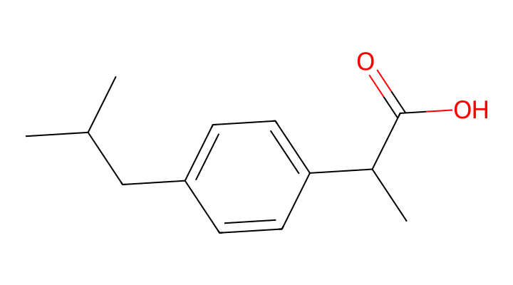

# 练习 01 · 从结构图设计路线

**练习约定**　本题接受外消旋产物。请从基础芳烃原料出发，说明每个新增碳原子的来源。

## 给火山方舟的提示词

请根据随附结构图设计完整的逆合成路线。先写出你读出的目标 SMILES，指出芳环取代位置、两侧支链的连接方式及立体化学要求。

接着解释你会优先断开哪根键、为什么。从你选择的起始原料正向写回目标，每步列出底物、产物、反应类型和决定产物结构的选择性。点出最需要查证的一步，说明可能形成什么竞争产物。

凡是引用实验结果，请写清原文位置、原文实际使用的底物、所得产物和数字的含义。暂时找不到原始实验时，请留下检索线索并标明待查。收尾时列明整条路线对原料、设备或立体控制的关键假设。
